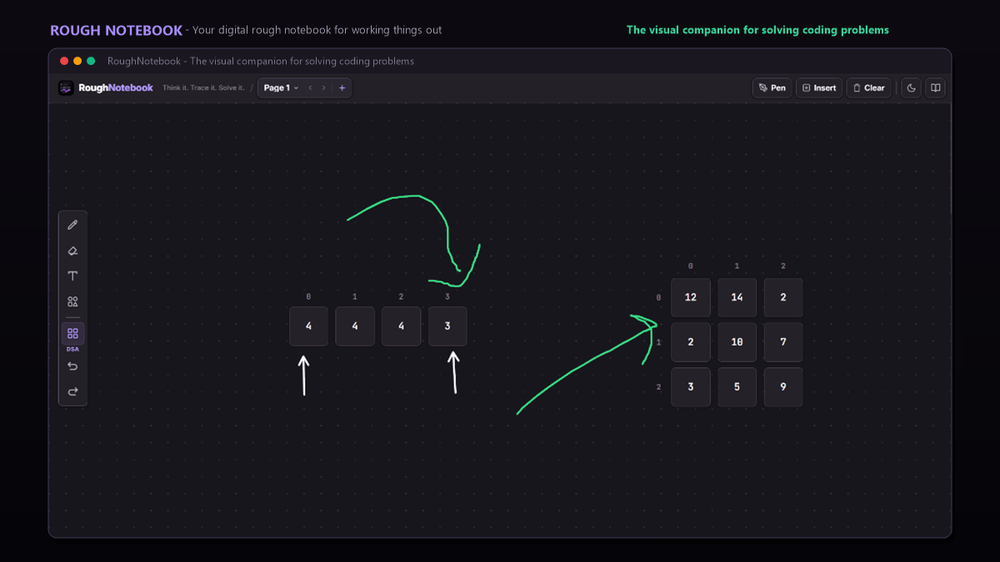

# Rough Notebook

**Your digital rough notebook for working things out.**  
*The visual companion for solving coding problems.*

Work through notes, sketches, and coding problems visually. Sketch your approach, test examples, trace arrays and pointers, and work through dynamic programming tables before writing your solution.

Works alongside your favourite coding practice platforms:
**LeetCode** &middot; **HackerRank** &middot; **Codeforces** &middot; **CodeChef** &middot; **GeeksforGeeks** &middot; **AtCoder**

[**Open Rough Notebook — free, no signup**](https://shambhoo-narwaria.github.io/Rough-Notebook/) &middot; [Report a bug or request a feature](https://github.com/shambhoo-narwaria/Rough-Notebook/issues)

[](https://shambhoo-narwaria.github.io/Rough-Notebook/)
[](https://github.com/shambhoo-narwaria/Rough-Notebook/stargazers)
[](LICENSE)
[](https://www.typescriptlang.org/)
[](https://svelte.dev/)

[](https://shambhoo-narwaria.github.io/Rough-Notebook/)

---

## How Rough Notebook fits into your workflow

When you open a coding challenge on LeetCode, HackerRank, or Codeforces, the hardest part is often tracking what changes at every step before writing code. Rough Notebook is designed to fit directly between understanding the problem and typing the solution:

```text
1. Find a problem         2. Think in Rough Notebook         3. Code & submit
   Open challenge on         Sketch approach, paste             Return to your platform
   LeetCode, HackerRank,     testcases, trace pointers,         or IDE with an airtight
   or Codeforces.            or fill a DP grid.                 mental model.
```

1. **Find a problem:** Open a challenge on LeetCode, HackerRank, Codeforces, or your preferred platform.
2. **Think in Rough Notebook:** Sketch your logic, dry-run test cases, trace variables, draw pointer arrows (`L`, `R`), or step through a dynamic programming recurrence table.
3. **Code and submit:** Return to your coding platform or editor and implement your solution with clarity.

---

## Where Rough Notebook fits

| Tool category | Main job |
| :--- | :--- |
| **Coding platforms** (LeetCode, HackerRank) | Present problems, run test suites, and evaluate submissions |
| **Progress trackers** (Codolio) | Record solved problems, track topic coverage, and manage revision |
| **AI coding assistants** | Provide hints, explanations, or code generation |
| **General note apps** (Notion, Obsidian) | Store long-term reference notes and documentation |
| **Rough Notebook** | **Give you a focused visual space to work through the problem yourself** |

Rough Notebook does not generate answers, collect submission history, or maintain a problem database. Its distinct advantage is the active working space between reading a problem and implementing the code.

---

## What you can work through

### 1. Freeform notes and sketches
- Jot down constraints, observations, loop invariants, and Big-O time and space complexity notes.
- Sketch diagrams freely, erase mistakes cleanly, and revise your thinking without redrawing from scratch.
- Keep text notes and visual diagrams together side by side on one surface.

### 2. Arrays, pointers, and test-case dry-runs
- Paste supported array inputs directly (including assignments like `nums = [2, 7, 11, 15]`) to instantly create structured, 0-indexed array blocks.
- Add pointer labels (`L`, `R`, `slow`, `fast`), directional arrows, and bounding boxes over elements.
- Visually trace two pointers, sliding windows, binary search bounds, or prefix sums.

### 3. Matrices and dynamic programming tables
- Create 2D grids for matrix problems, graph adjacency models, or DP memoization tables.
- Navigate across cells quickly using the keyboard (`Tab` and `Shift+Tab`).
- Record intermediate subproblem values while stepping through a recurrence relation.

### 4. Separate approaches on multiple rough sheets
- Keep different examples, brute-force ideas, and optimized solutions organized on separate sheets instead of crowding one page.
- Flip between pages instantly with `Alt+[` and `Alt+]`, or open a fresh sheet with `Alt+N`.

### 5. Three tailored workspace surfaces
- **Warm Paper Light**: High-readability ivory workspace with soft borders.
- **Natural Ivory Paper Mode**: Authentic handmade paper canvas with subtle organic cellulose fibers and an unruled blank sheet.
- **Tactile Obsidian Dark**: Deep obsidian dark surface (`#16141a`) with luminous lavender accents and high-contrast inks for low-light focus.

---

## Keyboard shortcuts

Rough Notebook works naturally with a mouse, trackpad, or stylus. Keyboard shortcuts are available for faster navigation and editing:

| Shortcut | Action | Description |
| :--- | :--- | :--- |
| `Ctrl+V` / `Cmd+V` | **Paste Test-Case** | Paste raw array or matrix input (e.g. `nums = [2, 7, 11, 15]`) |
| `/` or `Cmd+/` | **Command Palette** | Open quick-insert menu for notes, arrays, matrices, or spines |
| `P` | **Toggle Pen Mode** | Switch between pointer mode and freehand vector sketch mode |
| `E` | **Toggle Eraser** | Erase freehand sketches and pointer annotations |
| `S` | **Shape Tools** | Access Arrow, Square box, and Line tools |
| `D` | **DSA Quick Menu** | Insert common data structure blocks |
| `Tab` / `Shift+Tab` | **Grid Cell Traversal** | Navigate forward and backward between array or matrix cells |
| `Alt+N` | **New Rough Sheet** | Open a fresh clean page for your next problem |
| `Alt+[` / `Alt+]` | **Flip Sheets** | Move to the previous or next rough page |
| `Ctrl+Z` / `Cmd+Z` | **Undo** | Undo strokes and structural placements |
| `Ctrl+Y` / `Cmd+Shift+Z` | **Redo** | Redo previously undone actions |

> Shortcut behavior can vary by operating system and browser. If a shortcut conflicts with browser defaults, use the corresponding button in the interface.

---

## Privacy and storage

- **No account required:** Open the web app and start working immediately without signing up.
- **Local browser storage:** Rough Notebook runs locally in your browser; your work is stored on your device and is not synchronized to external servers.
- **Data retention notice:** Browser-stored work can be cleared when you clear site cookies, use private browsing, or switch devices. Copy or export anything you want to preserve long-term.

---

## Run locally

### Requirements

- Node.js (current supported LTS release, 18+)
- npm 9+

### Setup

```bash
# 1. Clone the repository
git clone https://github.com/shambhoo-narwaria/Rough-Notebook.git
cd Rough-Notebook

# 2. Install dependencies
npm install

# 3. Start local development server
npm run dev
```

Open the local URL printed by Vite in your terminal (commonly `http://localhost:5173`).

### Check and build

```bash
# Run Svelte and TypeScript checks
npm run check

# Build production bundle
npm run build

# Preview production build locally
npm run preview
```

---

## Contributing

Bug reports, usability feedback, and focused feature suggestions are welcome.

1. [Check existing issues](https://github.com/shambhoo-narwaria/Rough-Notebook/issues) before opening a new one.
2. Describe what you tried, what you expected, and what happened instead.
3. For code changes, make a focused branch and run `npm run check` and `npm run build` before opening a pull request.

---

## License

Rough Notebook is released under the [MIT License](LICENSE).

---

## Maintainer

Created and maintained by [Shambhoo Narwaria](https://github.com/shambhoo-narwaria).

If Rough Notebook helps you work through coding problems, consider [starring the repository](https://github.com/shambhoo-narwaria/Rough-Notebook) or sharing it with friends practicing DSA.
