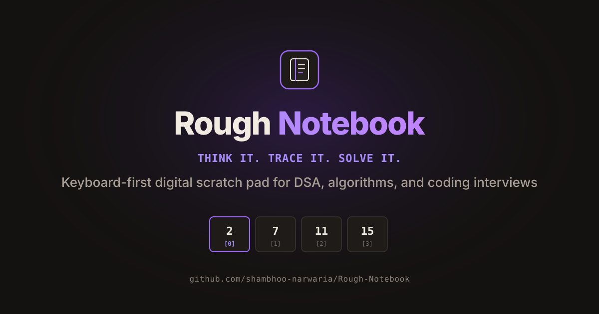
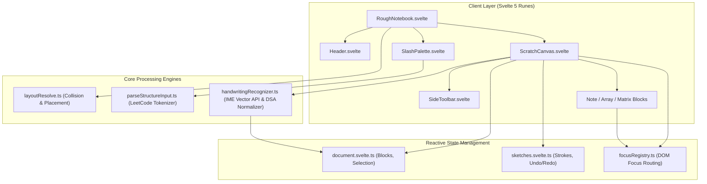

<p align="center">
  
</p>

<h1 align="center">Rough Notebook</h1>

<p align="center">
  <strong>Think it. Trace it. Solve it.</strong><br>
  A keyboard-first digital rough notebook designed for Data Structures & Algorithms, algorithm trace-tables, and technical coding interviews.
</p>

<p align="center">
  <a href="https://shambhoo-narwaria.github.io/Rough-Notebook/"><strong>Launch Live Application</strong></a> &bull;
  <a href="document/user_guide.md"><strong>User Guide</strong></a> &bull;
  <a href="document/architecture.md"><strong>Architecture Spec</strong></a> &bull;
  <a href="document/auto_handwriting_mode.md"><strong>Handwriting Engine</strong></a>
</p>

<p align="center">
  <a href="https://shambhoo-narwaria.github.io/Rough-Notebook/"></a>
  <a href="https://svelte.dev/"></a>
  <a href="https://www.typescriptlang.org/"></a>
  <a href="https://vite.dev/"></a>
  <a href="LICENSE"></a>
  
</p>

---

## Table of Contents

- [Overview](#overview)
- [Why Rough Notebook?](#why-rough-notebook)
- [Core Capabilities](#core-capabilities)
  - [1. Smart DSA Widgets](#1-smart-dsa-widgets)
  - [2. Instant Testcase Auto-Creation](#2-instant-testcase-auto-creation)
  - [3. Freehand Trace and Pen Layer](#3-freehand-trace-and-pen-layer)
  - [4. AI Smart Handwriting Engine](#4-ai-smart-handwriting-engine)
  - [5. Micro-Handle Block Repositioning](#5-micro-handle-block-repositioning)
  - [6. Dual Warm Themes](#6-dual-warm-themes)
- [Feature Comparison](#feature-comparison)
- [System Architecture](#system-architecture)
- [Project Directory Structure](#project-directory-structure)
- [Getting Started](#getting-started)
- [Deployment](#deployment)
- [Documentation Index](#documentation-index)
- [License and Attribution](#license-and-attribution)

---

## Overview

**Rough Notebook** is a high-velocity, browser-based digital scratchpad engineered specifically for algorithmic thinking, LeetCode practice, and technical whiteboard interviews. It blends the intuitive freedom of rough scrap paper with structured, reactive computational blocks (1D indexed arrays, 2D dynamic programming matrices, and freeform notes), all orchestrated through a strict keyboard-first interface.

The application executes entirely client-side with zero tracking, no login barriers, and instant startup times.

---

## Why Rough Notebook?

When tackling algorithmic problems, software engineers commonly struggle with existing tools:

- **Physical Scrap Paper:** Natural and rapid, but static. You cannot expand array capacities, duplicate testcases, cleanly shift pointer traces, or copy-paste problem inputs.
- **Generic Whiteboard Apps (Excalidraw, Miro):** Built for high-level software architecture boxes and circles. Drawing an array requires manually aligning 10 rectangles, typing indices individually, and navigating via heavy mouse drags.
- **Code Editors & Plain Text Notes:** Great for syntax, but completely lack 2D spatial layouts, cell-by-cell matrix tab navigation, and freehand pointer sketches (like two-pointer markers `L` and `R`, slow/fast runners, or recursion call trees).

Rough Notebook bridges this gap by delivering structured data widgets native to computer science workflows alongside a fluid freehand drawing canvas.

---

## Core Capabilities

### 1. Smart DSA Widgets

- **1D Indexed Arrays:** Dynamic array blocks featuring automated column index headers (`[0]`, `[1]`, `[2]`, ...). Add or remove elements with single keystrokes, adjust column widths, and quickly track array transformations across iterations.
- **2D Dynamic Programming Grids:** Grid widgets supporting custom dimensions, row and column headers, and seamless bidirectional cell navigation via `Tab` and `Shift+Tab`.
- **Freeform Sticky Notes:** Unobtrusive markdown-friendly text cards designed for edge case checklists, time/space complexity calculations, and invariant tracking.
- **Section Spines:** Vertical boundary lines that logically divide your canvas into stages (such as Brute Force vs. Optimized Two-Pointer vs. Binary Search).

### 2. Instant Testcase Auto-Creation

Copy raw test inputs directly from LeetCode problem descriptions or standard output and paste (`Cmd+V` / `Ctrl+V`) onto the canvas:

- Parses 1D arrays: `[2, 7, 11, 15]`, `2, 7, 11, 15`, or `["flower", "flow", "flight"]`.
- Parses 2D matrices: `[[1,2,3],[4,5,6]]` or whitespace-delimited table rows.
- Automatically instantiates populated, fully interactive widgets at your cursor position with zero manual formatting.

### 3. Freehand Trace and Pen Layer

- Sketch diagrammatic pointers, binary heap trees, graph edges, and linked list pointers directly over canvas objects.
- Curated color palette tailored for visual contrast:
  - **Ink:** Default structural ink.
  - **Red:** High-priority markers, boundary checks, and error conditions.
  - **Green:** Validated solutions, accepted base cases, and matches.
  - **Blue:** Auxiliary pointers, slow runners, and traversal paths.
- Isolated stroke undo stack: pressing `Cmd+Z` while drawing cleanly undos the last stroke without modifying placed structured blocks.

### 4. AI Smart Handwriting Engine

- **Continuous Background Recognition:** Write naturally on the canvas using a stylus, pen, or touch input; strokes are recognized and automatically converted into editable text within active notes without opening intrusive modal review windows.
- **DSA Token Normalization:** Candidate text is filtered through an algorithmic normalization dictionary that formats Big-O complexity (`O(1)`, `O(n)`, `O(log n)`, `O(n^2)`), pointer operations (`arr[i]`, `node->next`), and common variable names (`prev`, `curr`, `dummy`).
- **Concurrent Input:** Type with physical keyboard while writing with a stylus simultaneously.
- **Fail-Safe Retention:** Offline sessions or low-confidence sketches remain preserved permanently as raw vector ink.

### 5. Micro-Handle Block Repositioning

- Every placed block includes an unobtrusive 4-directional move handle (`17px x 17px`) positioned at its top-left corner.
- Drag any widget effortlessly across the infinite 3200px x 2400px virtual canvas without interfering with cell focus or text selection.
- Integrated non-overlap collision resolution automatically adjusts positions to prevent accidental visual overlapping.

### 6. Dual Warm Themes

- **Warm Light Canvas:** Dot-grid background reminiscent of premium engineered notebook paper, reducing glare during daylight sessions.
- **Warm Obsidian Dark Mode:** Deep, contrast-tuned background with vivid DSA syntax accents, designed to prevent ocular fatigue during late-night coding rounds.

---

## Feature Comparison

| Capability | Rough Notebook | Excalidraw | Physical Scrap Paper | Miro |
| :--- | :--- | :--- | :--- | :--- |
| **Primary Domain** | **DSA & Algorithm Dry-Runs** | General Diagramming | Manual Notes | Team Whiteboarding |
| **Indexed Array Widgets** | **Native** (Auto `[0]`, `[1]`, `[2]`) | Manual Shapes | Manual Pen | None |
| **DP Matrix Grid with Tab** | **Native** (Fast Tab traversal) | None | Manual Grid | None |
| **Paste LeetCode Testcases** | **Instant Auto-Detect** | None | None | None |
| **Handwriting to Code Engine** | **Native DSA Normalizer** | None | None | None |
| **Block Repositioning** | **4-Direction Move Handles** | Bounding Box | Cannot Move | Selection Box |
| **Keyboard Accelerators** | **Full** (`Cmd+/`, `Tab`, `Cmd+C/V`) | Mouse-Centric | None | Mouse-Centric |
| **Zero Account / Local-Only**| **100% Client-Side** | Yes | Yes | Requires Login |

> For complete keyboard workflows, shortcuts, and dry-run walkthroughs, refer to the [User Guide](document/user_guide.md) or click the in-app Help button.

---

## System Architecture



---

## Project Directory Structure

```text
Rough-Notebook/
├── public/                 # Static assets, manifests, and search metadata
│   ├── favicon.svg         # Scalable vector notebook favicon
│   ├── og.svg              # Vector social banner and open graph asset
│   ├── site.webmanifest    # Progressive Web App configuration
│   ├── robots.txt          # Crawler policy directives
│   ├── sitemap.xml         # XML index
│   ├── llms.txt            # Concise LLM machine-readable summary
│   └── llms-full.txt       # Detailed architectural and workflow guide for LLMs
├── src/
│   ├── components/
│   │   ├── blocks/         # NoteBlock, ArrayBlock, MatrixBlock, SpineBlock
│   │   ├── canvas/         # ScratchCanvas, SideToolbar, PenRadialMenu
│   │   ├── modals/         # HelpModal, AutoCreateModal, DimensionModal, ClearConfirmModal
│   │   └── navigation/     # Header bar, SlashPalette command menu
│   ├── library/            # Logic, data structures, and algorithmic helpers
│   │   ├── commands/       # Slash command definitions and filtering
│   │   ├── focus/          # Keyboard focus tracking and registry
│   │   ├── handwriting/    # Google IME handwriting pipeline and DSA token normalizer
│   │   ├── layout/         # Widget collision resolution and non-overlap placement
│   │   ├── parser/         # String, array, and matrix input parsing
│   │   └── state/          # Svelte 5 document and sketch reactive stores
│   ├── RoughNotebook.svelte # Root canvas coordinator
│   ├── main.ts             # Application bootstrapping
│   └── theme.css           # Vanilla CSS design tokens and theme rules
├── document/               # Technical specs and user documentation
│   ├── architecture.md     # Detailed architecture and data pipeline
│   ├── auto_handwriting_mode.md # Handwriting engine specification
│   └── user_guide.md       # Problem-solving workflows and guides
├── .github/workflows/      # Automated GitHub Actions deployment pipeline
├── vite.config.ts          # Vite build and path alias configuration
├── tsconfig.json           # TypeScript strict configuration
└── package.json            # Scripts and runtime dependencies
```

---

## Getting Started

### Prerequisites

- **Node.js 18+** or modern LTS installed.
- **npm 9+** package manager.

### 1. Clone the Repository

```bash
git clone https://github.com/shambhoo-narwaria/Rough-Notebook.git
cd Rough-Notebook
```

### 2. Install Dependencies

```bash
npm install
```

### 3. Launch Development Server

```bash
npm run dev
```

Navigate to `http://localhost:5173` in your browser. Hot module reloading (HMR) is active.

### 4. Run Type Checks

Validate strict TypeScript typing and Svelte component templates:

```bash
npm run check
```

### 5. Production Build

Compile the production bundle to `dist/`:

```bash
npm run build
```

---

## Deployment

The application is deployed to GitHub Pages from the `gh-pages` branch.

To build and deploy updates manually:

```bash
npm run deploy
```

Alternatively, push to `main` to trigger the automated GitHub Actions workflow defined in `.github/workflows/deploy.yml`.

- **Live URL:** [https://shambhoo-narwaria.github.io/Rough-Notebook/](https://shambhoo-narwaria.github.io/Rough-Notebook/)

---

## Documentation Index

- **[User Guide](document/user_guide.md):** Step-by-step problem-solving workflows for two-pointers, sliding window, and dynamic programming.
- **[Architecture Specification](document/architecture.md):** Deep-dive into Svelte 5 Runes reactivity, focus registry, and layout collision resolution.
- **[Auto Handwriting Engine](document/auto_handwriting_mode.md):** Coordinate transformation, Google IME vector communication, and Big-O token normalization.
- **[LLM Machine Context](public/llms.txt):** Optimized machine summary for AI assistants and generative engines.

---

## License and Attribution

Distributed under the **MIT License**. See [`LICENSE`](LICENSE) for complete details.

Crafted by [**Shambhoo Narwaria**](https://github.com/shambhoo-narwaria). Contributions and feedback are welcome.
